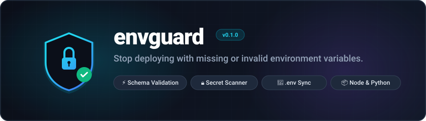

<p align="center">
  
</p>

<p align="center">
  
  
  
  <a href="./LICENSE"></a>
  
</p>

---

## The Problem

Environment variables are the #1 source of "works on my machine" bugs:

- **Missing vars crash production** — a forgotten `DATABASE_URL` takes down your app at 2 AM.
- **No single source of truth** — `.env.example` drifts out of sync with what the app actually needs.
- **Secrets leak into logs and repos** — without guardrails, API keys end up in places they shouldn't.
- **Onboarding is painful** — new developers spend hours figuring out which vars to set and what format they need.

## The Solution

**envguard** is a schema-driven CLI that validates, syncs, and secures your environment variables — before your code ever runs.

- 📋 **Schema-driven validation** — Define every variable's type, constraints, and defaults in a single `envguard.yaml` file. Validate on every build.
- 🔄 **`.env.example` sync** — Automatically keep your `.env.example` in lockstep with your schema. No more stale templates.
- 🔐 **Secret scanning** — Detect leaked secrets in `.env` files, shell history, and CI logs before they reach version control.
- 🚀 **Interactive onboarding** — `envguard onboard` walks new developers through every required variable with prompts, descriptions, and sensible defaults.

---

## Quick Start

### 1. Install

**Go install:**

```bash
go install github.com/RINKESH2497/envguard/cmd/envguard@latest
```

**Build from source:**

```bash
git clone https://github.com/RINKESH2497/envguard.git
cd envguard
make build
# Binary created at bin/envguard
```

**Binary releases:**

Download pre-built binaries from the [Releases](https://github.com/RINKESH2497/envguard/releases) page for Linux, macOS, and Windows (amd64/arm64).

### 2. Init

Generate an `envguard.yaml` schema from your existing `.env` file:

```bash
envguard init
```

This inspects your `.env`, infers types, and produces a ready-to-customize schema.

### 3. Check

Validate your environment against the schema:

```bash
envguard check
```

```
✓ DATABASE_URL    valid
✓ PORT            valid (default: 3000)
✗ API_KEY         MISSING — required variable not set
✓ NODE_ENV        valid

1 error, 0 warnings — validation failed
```

---

## Commands

| Command              | Description                                                        |
| -------------------- | ------------------------------------------------------------------ |
| `envguard init`      | Generate `envguard.yaml` from an existing `.env` file              |
| `envguard check`     | Validate current environment against the schema                    |
| `envguard sync`      | Sync `.env.example` with the schema (add missing, remove stale)    |
| `envguard scan`      | Scan files and directories for leaked secrets                      |
| `envguard onboard`   | Interactive wizard to populate a `.env` for new developers         |

### Flags & Options

**Global Flags:**

| Flag               | Description                              | Default           |
| ------------------ | ---------------------------------------- | ----------------- |
| `--config, -c`     | Path to schema file                      | `envguard.yaml`   |
| `--quiet, -q`      | Suppress non-essential output            | `false`           |
| `--no-color`       | Disable colored output                   | `false`           |

**Command Flags:**

- `check`:
  - `--env, -e`: Path to `.env` file (default: `.env`)
  - `--strict`: Treat warnings as errors
  - `--env-source`: Source of variables (`file`, `env`, or `auto`)
- `sync`:
  - `--output, -o`: Path to `.env.example` output
  - `--descriptions`: Include descriptions (default: `true`)
  - `--types`: Include types and required annotations (default: `true`)
  - `--group-required`: Group into Required/Optional sections (default: `false`)
- `scan`:
  - `--recursive, -r`: Scan directories recursively (default: `true`)
  - `--entropy`: Minimum Shannon entropy threshold (default: `4.5`)
  - `--exclude`: Glob pattern to exclude (e.g. `*.log`)
- `onboard`:
  - `--env, -e`: Target `.env` file path (default: `.env`)
  - `--skip-optional`: Skip prompting for optional variables
  - `--use-defaults`: Automatically accept default values

---

## Schema Reference

The `envguard.yaml` file is the single source of truth for your environment. Here's the full specification:

```yaml
# envguard.yaml — full schema reference
version: "1"

# Optional metadata
meta:
  name: my-app
  description: Environment schema for My Application

variables:
  # Required string with regex pattern validation
  DATABASE_URL:
    type: string
    required: true
    description: "PostgreSQL connection string"
    pattern: "^postgres://.+"
    secret: true

  # URL type with automatic format validation
  REDIS_URL:
    type: url
    required: false
    default: "redis://localhost:6379"
    description: "Redis connection URL"

  # Integer with range constraints
  PORT:
    type: integer
    required: false
    default: 3000
    description: "HTTP server port"
    min: 1
    max: 65535

  # Enum — only specific values allowed
  NODE_ENV:
    type: string
    required: true
    description: "Application environment"
    allowed:
      - development
      - staging
      - production

  # Secret — masked in logs, flagged by scan
  API_KEY:
    type: string
    required: true
    description: "External API key"
    secret: true

  # Boolean with default
  ENABLE_CACHE:
    type: boolean
    required: false
    default: true
    description: "Enable Redis caching layer"

  # String with example value for onboarding
  CORS_ORIGINS:
    type: string
    required: false
    description: "Comma-separated allowed origins"
    example: "https://example.com,https://app.example.com"
```

### Field Types

| Type      | Description                          | Validation                       |
| --------- | ------------------------------------ | -------------------------------- |
| `string`  | Any string value                     | `pattern`, `allowed`, `min_length`, `max_length` |
| `integer` | Whole number                         | `min`, `max`                     |
| `float`   | Decimal number                       | `min`, `max`                     |
| `boolean` | `true`/`false`, `1`/`0`, `yes`/`no` | Automatic parsing                |
| `url`     | Valid URL                            | Format validation                |
| `email`   | Valid email address                  | Format validation                |

### Variable Properties

| Property      | Type       | Description                                          |
| ------------- | ---------- | ---------------------------------------------------- |
| `type`        | `string`   | Data type (see above)                                |
| `required`    | `bool`     | Whether the variable must be set (default: `false`)  |
| `default`     | `any`      | Default value when not set                           |
| `description` | `string`   | Human-readable description                           |
| `secret`      | `bool`     | Mask in output, flag in scans (default: `false`)     |
| `pattern`     | `string`   | Regex pattern for string validation                  |
| `allowed`     | `[]string` | List of allowed values (enum)                        |
| `example`     | `string`   | Example value shown during onboarding                |
| `min`         | `number`   | Minimum value (integer/float)                        |
| `max`         | `number`   | Maximum value (integer/float)                        |
| `min_length`  | `int`      | Minimum string length                                |
| `max_length`  | `int`      | Maximum string length                                |
| `deprecated`  | `string`   | Deprecation notice — emits a warning if set          |

---

## Runtime SDKs

envguard provides runtime validation SDKs so your application can enforce the schema at startup — not just in CI.

### Python

```python
import envguard

# Validates process environment against envguard.yaml at startup
# Raises envguard.ValidationError on failure
envguard.check()

# Or use as decorator for application factories (Flask / FastAPI):
@envguard.guard()
def create_app():
    ...
```

```bash
pip install py-envguard
```

### Node.js / TypeScript

```typescript
import { check, guard } from 'envguard';

// Validates process.env against envguard.yaml at startup
// Throws ValidationError on failure
check();

// Or as Express middleware:
app.use(guard());
```

```bash
npm install envguard
```

---

## GitHub Action

Use envguard in your CI pipeline with the official GitHub Action:

```yaml
# .github/workflows/ci.yml
- name: Validate environment
  uses: RINKESH2497/envguard/action@main
  with:
    command: check
    schema-path: envguard.yaml
    env-path: .env.ci
    strict: true
```

### Inputs

| Input          | Description                                    | Default           |
| -------------- | ---------------------------------------------- | ----------------- |
| `command`      | Command to run (`check`, `sync`, `scan`)       | `check`           |
| `schema-path`  | Path to `envguard.yaml`                        | `envguard.yaml`   |
| `env-path`     | Path to `.env` file                            | `.env`            |
| `strict`       | Treat warnings as errors                       | `false`           |
| `version`      | envguard version to install                    | `latest`          |

---

## Pre-commit Hook

Add envguard to your `.pre-commit-config.yaml`:

```yaml
repos:
  - repo: https://github.com/RINKESH2497/envguard
    rev: v0.1.0
    hooks:
      - id: envguard-check
      - id: envguard-scan
```

Or add it manually to `.git/hooks/pre-commit`:

```bash
#!/bin/sh
envguard check --strict
envguard scan
```

---

## CI Integration

### GitHub Actions (full example)

```yaml
name: CI
on:
  push:
    branches: [main]
  pull_request:
    branches: [main]

jobs:
  validate-env:
    runs-on: ubuntu-latest
    steps:
      - uses: actions/checkout@v4
      - uses: actions/setup-go@v5
        with:
          go-version: "1.23"
      - run: go install github.com/RINKESH2497/envguard/cmd/envguard@latest
      - run: envguard check --config envguard.yaml --env .env.ci --strict
      - run: envguard scan .
```

### GitLab CI

```yaml
validate-env:
  image: golang:1.23
  script:
    - go install github.com/RINKESH2497/envguard/cmd/envguard@latest
    - envguard check --strict
    - envguard scan .
```

### Docker

```dockerfile
# Multi-stage: install envguard
FROM golang:1.23-alpine AS envguard
RUN go install github.com/RINKESH2497/envguard/cmd/envguard@latest

FROM your-app-image
COPY --from=envguard /go/bin/envguard /usr/local/bin/envguard
COPY envguard.yaml .
RUN envguard check --strict
```

---

## Contributing

We welcome contributions! Please see [CONTRIBUTING.md](./CONTRIBUTING.md) for guidelines on:

- Reporting bugs and requesting features
- Setting up your development environment
- Code style and PR process

---

## License

envguard is released under the [MIT License](./LICENSE).

Copyright (c) 2026 envguard contributors
